# Section 5: Getting Started

Tool used: Questa Sim

## Task 1: Hello Gate

### AND Gate

#### 1. Schematic Diagram
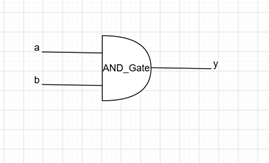

#### 2. Terminal Output
Compilation of design and testbench:

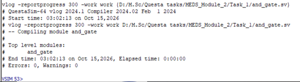
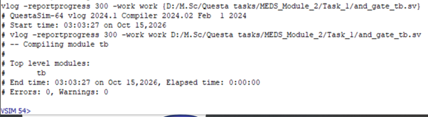

Simulation output:

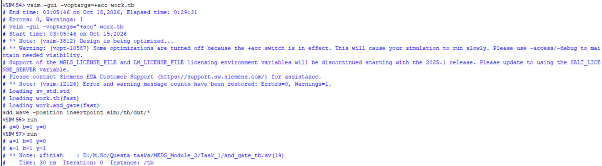

#### 3. Waveform
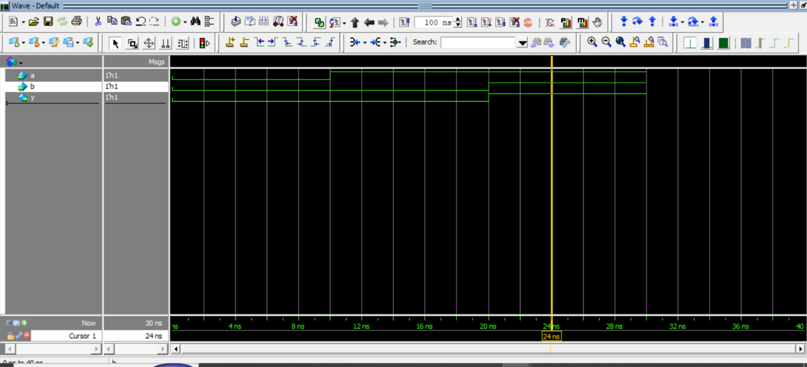

### OR Gate

#### 1. Schematic Diagram
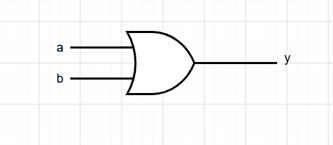

#### 2. Terminal Output
Compilation of design and testbench:

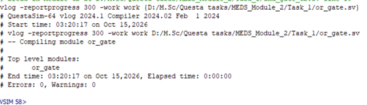
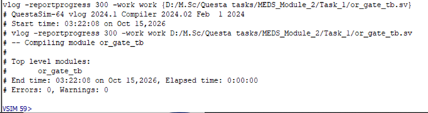

Simulation output:

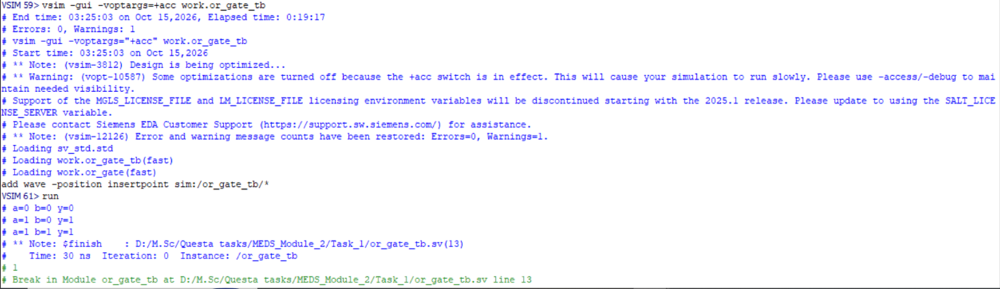

#### 3. Waveform
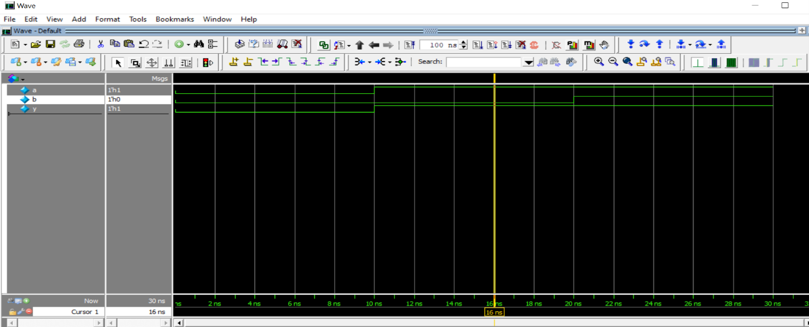

### XOR Gate

#### 1. Schematic Diagram
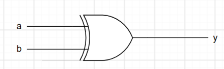

#### 2. Terminal Output
Compilation of design and testbench:

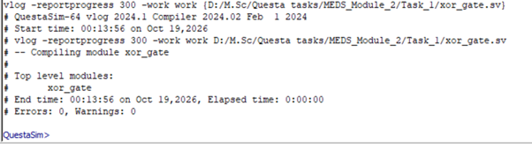
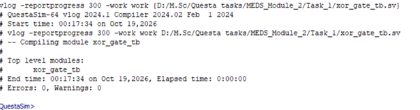

Simulation output:

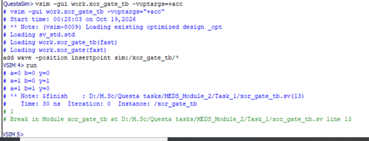

#### 3. Waveform
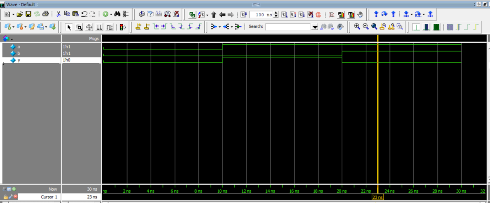

### 4. Explanation
In this task I wrote a 2-input AND gate in SystemVerilog using a continuous assignment (`assign y = a & b;`) and tested it with a simple testbench in Questa Sim. I then repeated the same process for the OR and XOR gates.

Each testbench applies all four input combinations (00, 01, 10, 11) to `a` and `b`, and waits 10 time units after each change so the output can settle. After every change, `$display` prints the values of `a`, `b` and `y` in the simulation log. The results matched the truth tables: AND gives 1 only when both inputs are 1, OR gives 1 when at least one input is 1, and XOR gives 1 only when the inputs are different.

In the waveforms, the output changes right after the inputs change, and no clock is involved. This shows that all three circuits are purely combinational. The waveforms agree with the log output and the truth tables.

---

## Task 2: Convert to a Self-Checking Testbench

### 1. Schematic Diagram

### 2. Terminal Output
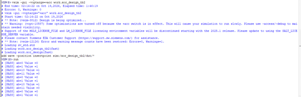

### 3. Waveform
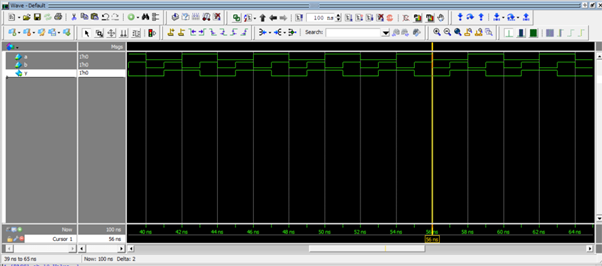

### 4. Explanation
In this task I rewrote the XOR testbench so that it checks the output on its own instead of me reading the log by eye. A `check()` task compares the DUT output `y` with an expected value and prints `[PASS]` or `[FAIL]` for each input vector.

The expected value comes from a separate function, `expected_fn()`, which computes `a ^ b` independently of the DUT. A `for` loop goes through all four input combinations and waits 1 time unit before each check so the combinational output can settle. I used `!==` for the comparison so that an X or Z on the output is also reported as a failure.

All four vectors printed `[PASS]`, which matches the XOR truth table.