# Section 6: Combinational Design Practices

Tool used: Questa Sim

## Task 3: Half Adder and Full Adder (assign vs always_comb)

### Half Adder

Two versions of the half adder are written in the same file. One uses only continuous `assign` statements, and the other uses an `always_comb` block with if-else. Both are instantiated in the testbench and driven with the same inputs, and their outputs are compared for all 4 input combinations.

#### 1. Schematic Diagram
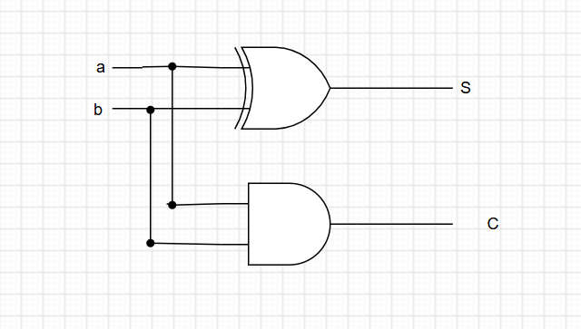

#### 2. Terminal Output
Single half adder:

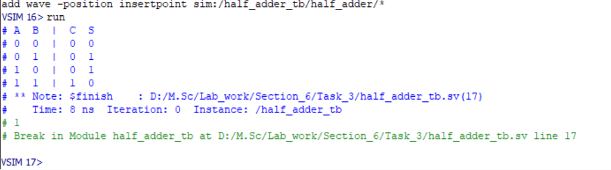

Both versions (assign and always_comb) compared together:

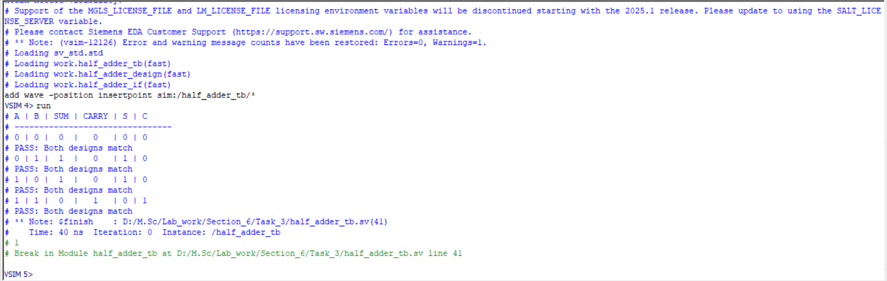

#### 3. Waveform
Single half adder:

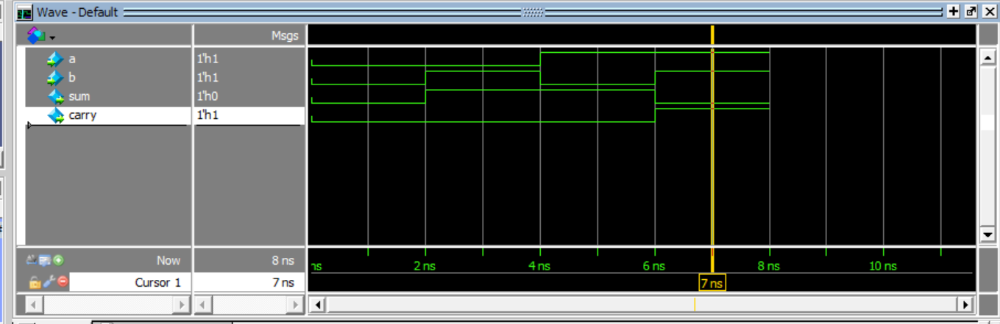

Both versions together:

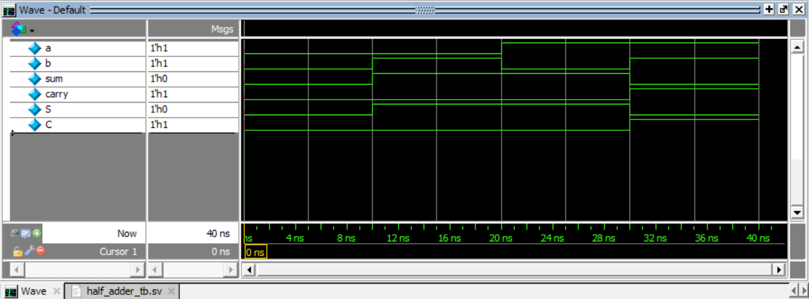

---

### Full Adder

The full adder is built structurally from two half adders and one OR gate. The first half adder adds `a` and `b`. The second half adder adds that partial sum to `cin`. The final carry-out is the OR of the two half-adder carries.

#### 1. Schematic Diagram
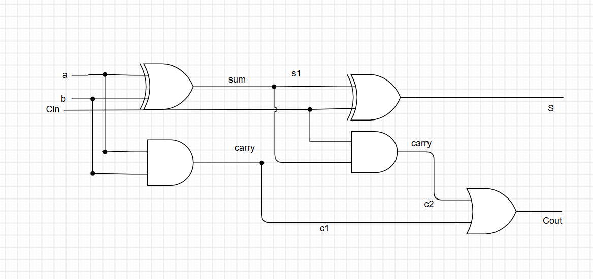

#### 2. Terminal Output
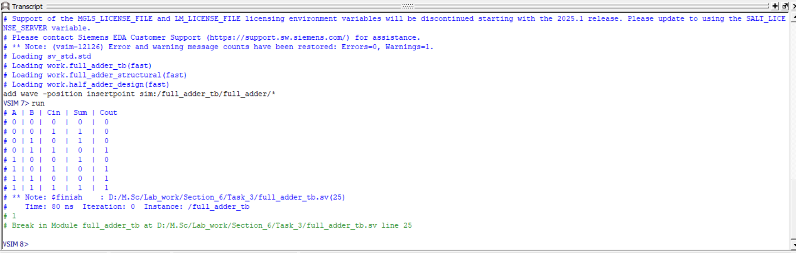

#### 3. Waveform
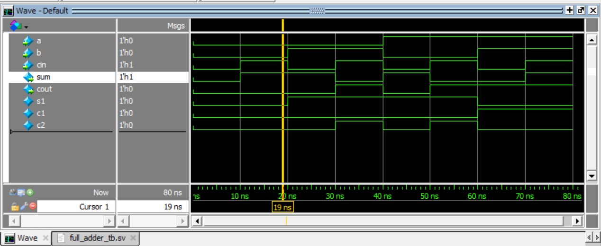

---

### 4. Explanation

**Half adder.** A half adder adds two 1-bit inputs. The sum is `a ^ b` and the carry is `a & b`. In the `assign` version I wrote these two equations directly. In the `always_comb` version I used if-else to cover each input case and set `sum` and `carry` in every branch, so no latch is created. When I ran both versions in the testbench for all four input combinations (00, 01, 10, 11), their outputs were identical, as the terminal output and waveform show.

**Why both versions give the same gates.** The synthesis tool does not care about how the code is written. It only looks at what the circuit has to do, which is the truth table. Both versions describe the same combinational function: sum is 1 only when the inputs differ, and carry is 1 only when both inputs are 1. The tool reduces both descriptions to the same logic, which is one XOR gate and one AND gate. `assign` just states the equation directly, while `always_comb` states the same behaviour step by step, but since every branch assigns every output, there is no memory in either one. The two versions are therefore the same hardware written in two different styles.

**Full adder.** For the full adder I connected two half adders and an OR gate. The first half adder gives a partial sum and a partial carry from `a` and `b`. The second half adder adds `cin` to the partial sum, which gives the final `sum`. A carry-out happens if either half adder produced a carry, so the two carries go into an OR gate to give `cout`. The simulation matched the full adder truth table for all 8 combinations of `a`, `b` and `cin`.

---

## Task 4: NOR-Only Realization

Function: f = (b + c + d)(a' + b + c)(a' + d)

### 1. Schematic Diagram
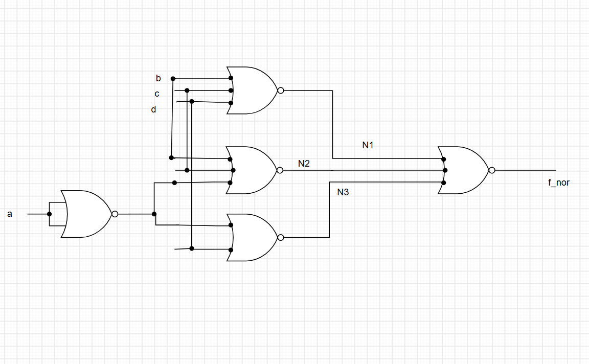

### 2. Terminal Output
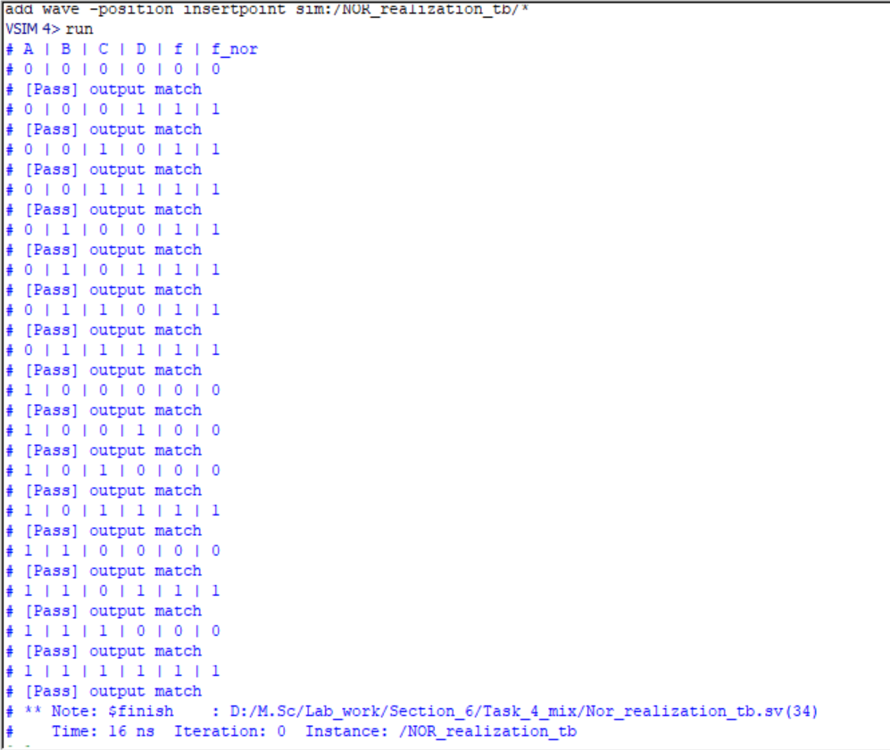

### 3. Waveform
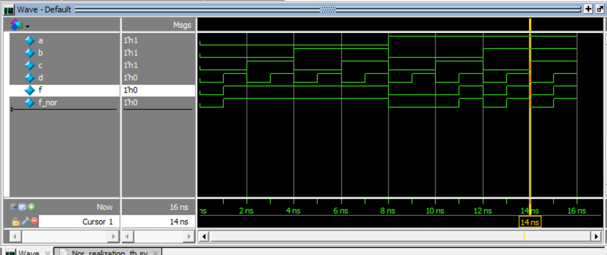

### 4. Explanation

**Boolean / De Morgan derivation.** The given function is already a product of sums:

f = (b + c + d)(a' + b + c)(a' + d)

A NOR gate gives the complement of an OR, so (x + y + z)' = NOR(x, y, z). To bring the expression into NOR form, I double-complemented f. This does not change the function:

f = [ (b + c + d)(a' + b + c)(a' + d) ]''

Applying De Morgan's law to the inner complement (the complement of a product is the sum of the complements):

f = [ (b + c + d)' + (a' + b + c)' + (a' + d)' ]'

Each complemented sum is a single NOR gate:

- T1 = (b + c + d)' = NOR(b, c, d)
- T2 = (a' + b + c)' = NOR(a', b, c)
- T3 = (a' + d)' = NOR(a', d)

The outer complement of the sum T1 + T2 + T3 is one more NOR gate:

f = NOR(T1, T2, T3)

The input a' is needed inside T2 and T3. A NOR gate with both inputs tied to a gives a' (NOR(a, a) = a'), so the inverter is also made from a NOR gate. No other gate type is used.

**Final network:** 5 NOR gates in total: one for a', three at the second level (T1, T2, T3), and one 3-input NOR at the output.

**SystemVerilog implementation.** I wrote f in two ways:

1. Direct: `assign f_direct = (b | c | d) & (~a | b | c) & (~a | d);`
2. NOR-only, using the `~|` pattern from the derivation:
   - `assign na = ~|{a, a};`
   - `assign t1 = ~|{b, c, d};`
   - `assign t2 = ~|{na, b, c};`
   - `assign t3 = ~|{na, d};`
   - `assign f_nor = ~|{t1, t2, t3};`

**Verification.** The testbench sweeps all 16 combinations of a, b, c and d, and compares `f_direct` with `f_nor` for each one. The terminal output shows that both implementations match for every combination, and the waveform shows the two outputs staying identical as the inputs change. This confirms that the NOR-only network is equivalent to the original expression.

---

## Task 5: 4-bit Parity Generator

### 1. Schematic Diagram
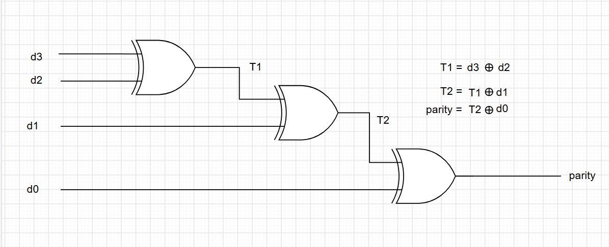

### 2. Terminal Output
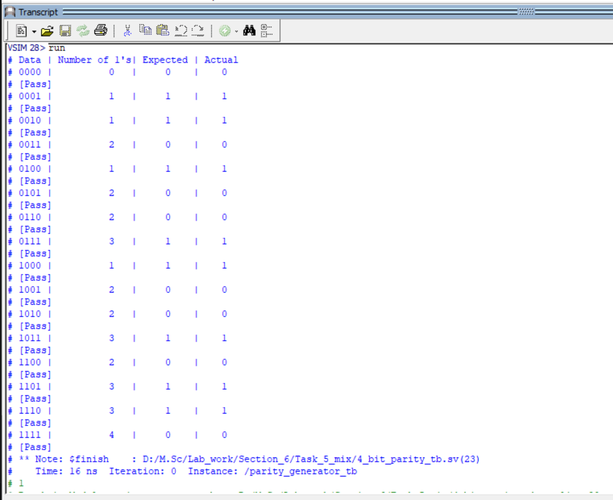

### 3. Waveform
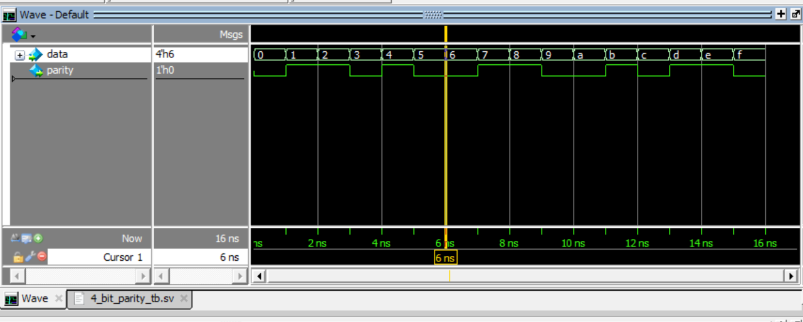

### 4. Explanation

This module takes a 4-bit input `data` and produces a 1-bit output `parity`. The output is 1 when the number of 1s in `data` is odd, and 0 when it is even.

The design uses the reduction XOR operator in a single continuous assignment:

`assign parity = ^data;`

The reduction XOR works as `data[3] ^ data[2] ^ data[1] ^ data[0]`. XOR gives 1 when its two inputs differ, so each 1 in the data flips the running result. After all four bits are processed, the result is 1 if the count of 1s is odd and 0 if it is even. This is why a single reduction XOR gives the required parity directly.

The testbench loops through all 16 values of `data` (0000 to 1111). For each value it waits for the combinational output to settle and compares `parity` with an expected value computed independently using `$countones(data) % 2`. The terminal output shows the result for every combination, and the waveform shows `parity` going high only for inputs with an odd number of 1s (for example 0001, 0010, 0100, 1000, 0111, 1011, 1101, 1110).