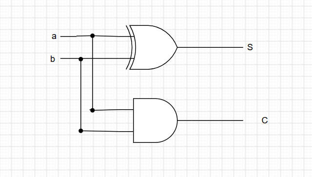
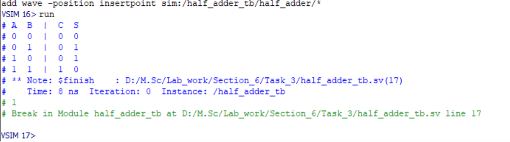
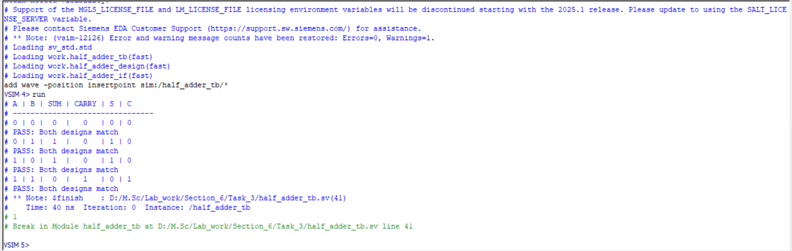
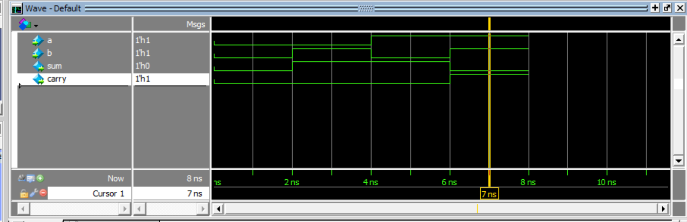
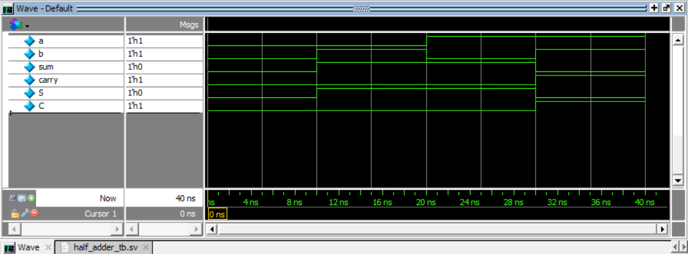
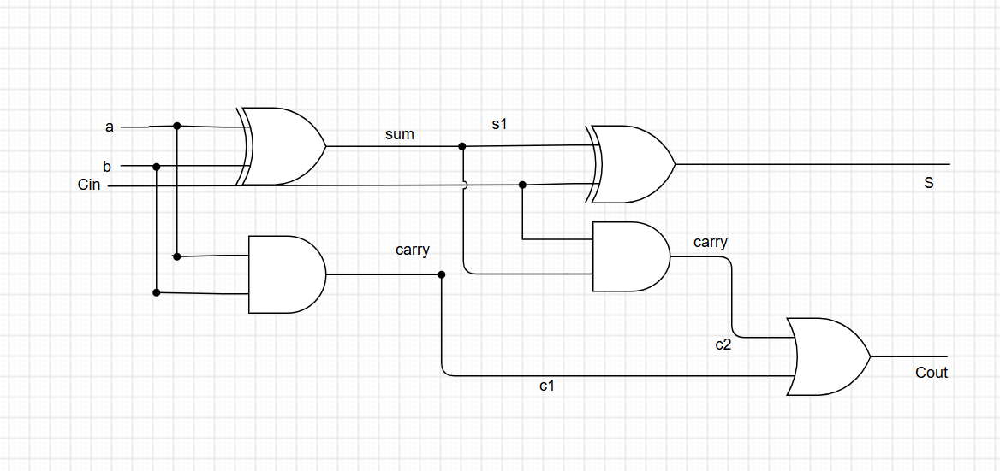
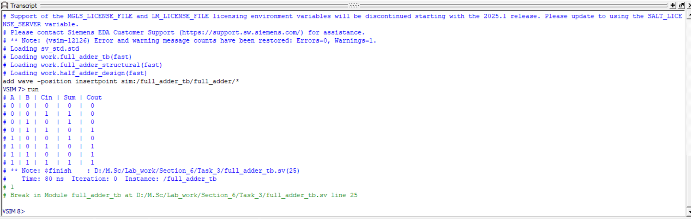
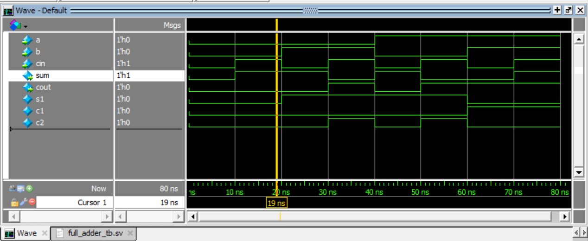

# Section 6: Combinational Design Practices

Tool used: Questa Sim

## Task 3: Half Adder and Full Adder (assign vs always_comb)

### Half Adder

Two versions of the half adder are written in the same file. One uses only continuous `assign` statements, and the other uses an `always_comb` block with if-else. Both are instantiated in the testbench and driven with the same inputs, and their outputs are compared for all 4 input combinations.

#### 1. Schematic Diagram

#### 2. Terminal Output
Single half adder:

Both versions (assign and always_comb) compared together:

#### 3. Waveform
Single half adder:

Both versions together:

---

### Full Adder

The full adder is built structurally from two half adders and one OR gate. The first half adder adds `a` and `b`. The second half adder adds that partial sum to `cin`. The final carry-out is the OR of the two half-adder carries.

#### 1. Schematic Diagram

#### 2. Terminal Output

#### 3. Waveform

---

### 4. Explanation

"Half adder." A half adder adds two 1-bit inputs. The sum is `a ^ b` and the carry is `a & b`. In the `assign` version I wrote these two equations directly. In the `always_comb` version I used if-else to cover each input case and set `sum` and `carry` in every branch, so no latch is created. When I ran both versions in the testbench for all four input combinations (00, 01, 10, 11), their outputs were identical, as the terminal output and waveform show.
"Why both versions give the same gates." The synthesis tool does not care about how the code is written. It only looks at what the circuit has to do, which is the truth table. Both versions describe the same combinational function: sum is 1 only when the inputs differ, and carry is 1 only when both inputs are 1. The tool reduces both descriptions to the same logic, which is one XOR gate and one AND gate. `assign` just states the equation directly, while `always_comb` states the same behaviour step by step, but since every branch assigns every output, there is no memory in either one. The two versions are therefore the same hardware written in two different styles.

"Full adder." For the full adder I connected two half adders and an OR gate. The first half adder gives a partial sum and a partial carry from `a` and `b`. The second half adder adds `cin` to the partial sum, which gives the final `sum`. A carry-out happens if either half adder produced a carry, so the two carries go into an OR gate to give `cout`. The simulation matched the full adder truth table for all 8 combinations of `a`, `b` and `cin`.