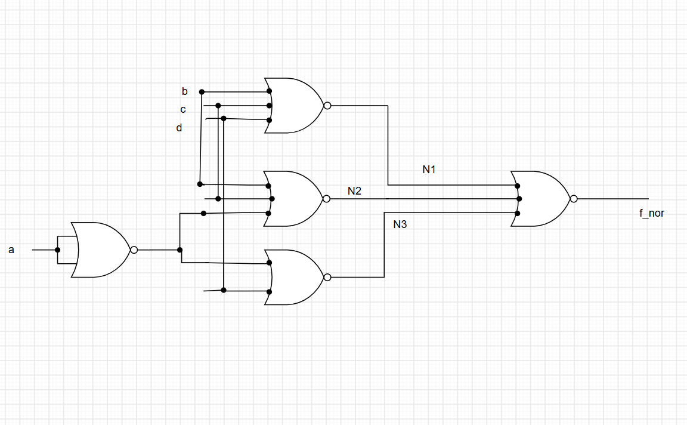
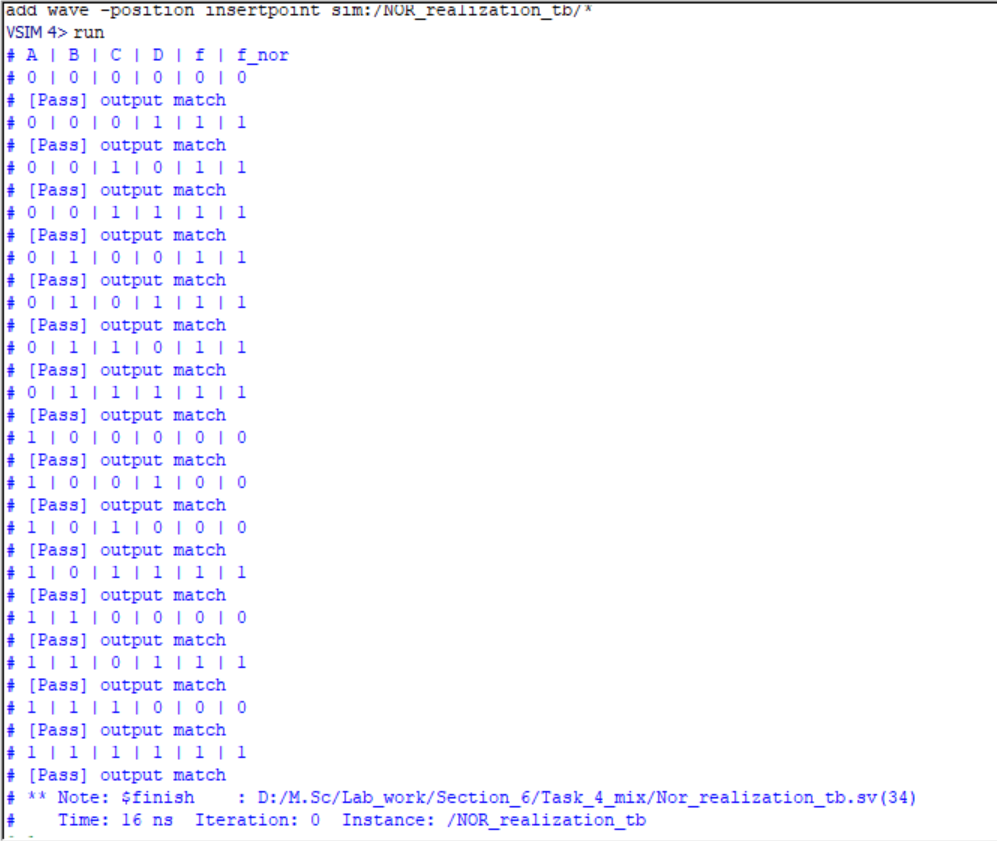
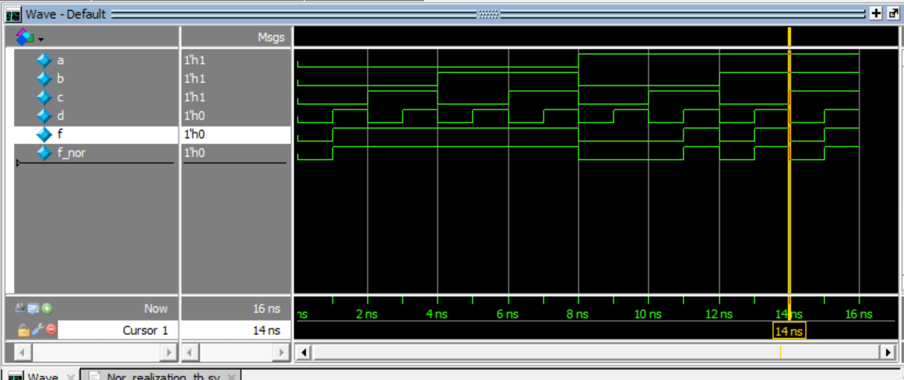

---

## Task 4: NOR-Only Realization

Function: f = (b + c + d)(a' + b + c)(a' + d)

### 1. Schematic Diagram

### 2. Terminal Output

### 3. Waveform

### 4. Explanation

**Boolean / De Morgan derivation.** The given function is already a product of sums:

f = (b + c + d)(a' + b + c)(a' + d)

A NOR gate gives the complement of an OR, so (x + y + z)' = NOR(x, y, z). To bring the expression into NOR form, I double-complemented f. This does not change the function:

f = [ (b + c + d)(a' + b + c)(a' + d) ]''

Applying De Morgan's law to the inner complement (the complement of a product is the sum of the complements):

f = [ (b + c + d)' + (a' + b + c)' + (a' + d)' ]'

Each complemented sum is a single NOR gate:

- T1 = (b + c + d)' = NOR(b, c, d)
- T2 = (a' + b + c)' = NOR(a', b, c)
- T3 = (a' + d)' = NOR(a', d)

The outer complement of the sum T1 + T2 + T3 is one more NOR gate:

f = NOR(T1, T2, T3)

The inputs a' is needed inside T2 and T3. A NOR gate with both inputs tied to a gives a' (NOR(a, a) = a'), so the inverter is also made from a NOR gate. No other gate type is used.

**Final network:** 5 NOR gates in total: one for a', three at the second level (T1, T2, T3), and one 3-input NOR at the output.

**SystemVerilog implementation.** I wrote f in two ways:

1. Direct: `assign f_direct = (b | c | d) & (~a | b | c) & (~a | d);`
2. NOR-only, using the `~|` pattern from the derivation:
   - `assign na = ~|{a, a};`
   - `assign t1 = ~|{b, c, d};`
   - `assign t2 = ~|{na, b, c};`
   - `assign t3 = ~|{na, d};`
   - `assign f_nor = ~|{t1, t2, t3};`

**Verification.** The testbench sweeps all 16 combinations of a, b, c and d, and compares `f_direct` with `f_nor` for each one. The terminal output shows that both implementations match for every combination, and the waveform shows the two outputs staying identical as the inputs change. This confirms that the NOR-only network is equivalent to the original expression.