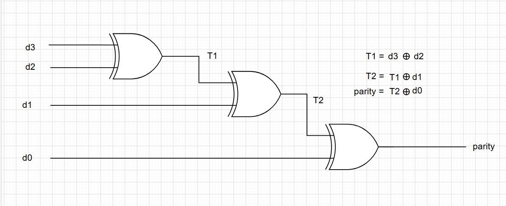
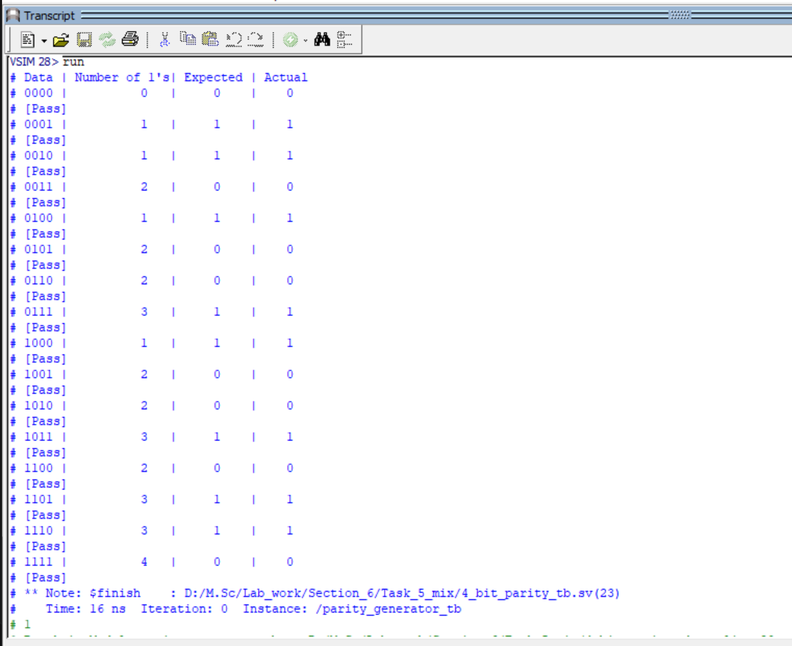
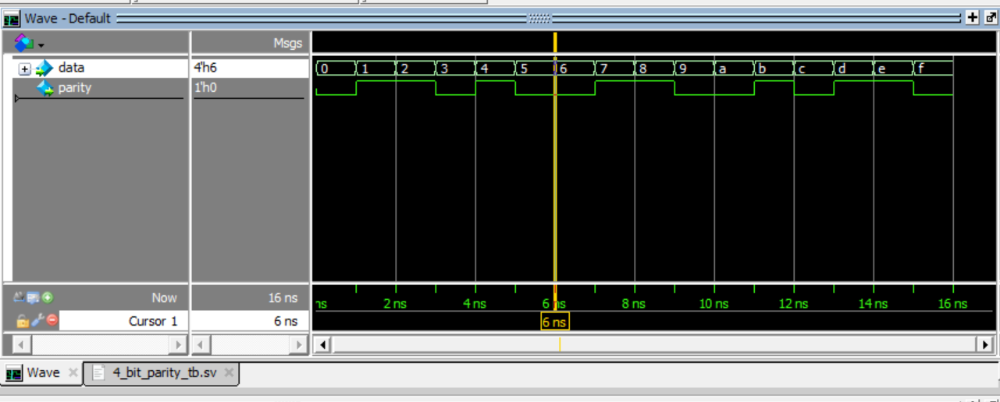

# Task 5: 4-bit Parity Generator

Tool used: Questa Sim

## 1. Schematic Diagram

## 2. Terminal Output

## 3. Waveform

## 4. Explanation

This module takes a 4-bit input `data` and produces a 1-bit output `parity`. The output is 1 when the number of 1s in `data` is odd, and 0 when it is even.

The design uses the reduction XOR operator in a single continuous assignment:

`assign parity = ^data;`

The reduction XOR works as `data[3] ^ data[2] ^ data[1] ^ data[0]`. XOR gives 1 when its two inputs differ, so each 1 in the data flips the running result. After all four bits are processed, the result is 1 if the count of 1s is odd and 0 if it is even. This is why a single reduction XOR gives the required parity directly.

The testbench loops through all 16 values of `data` (0000 to 1111). For each value it waits for the combinational output to settle and compares `parity` with an expected value computed independently using `$countones(data) % 2`. The terminal output shows the result for every combination, and the waveform shows `parity` going high only for inputs with an odd number of 1s (for example 0001, 0010, 0100, 1000, 0111, 1011, 1101, 1110).