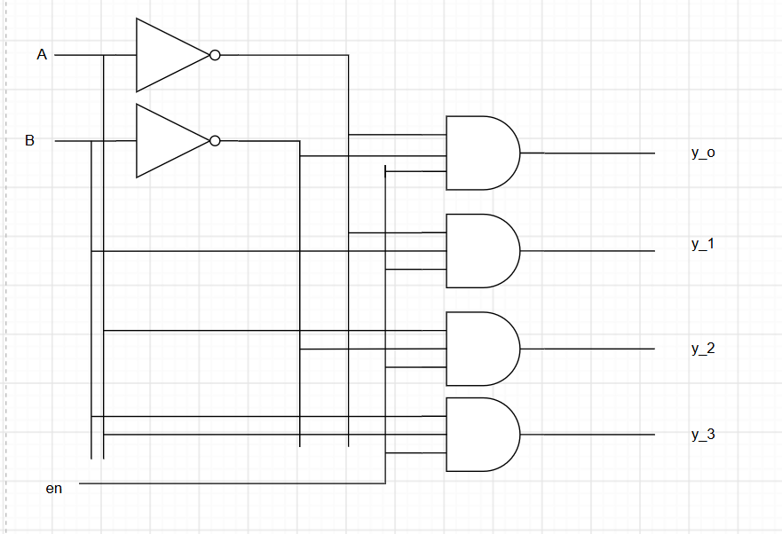
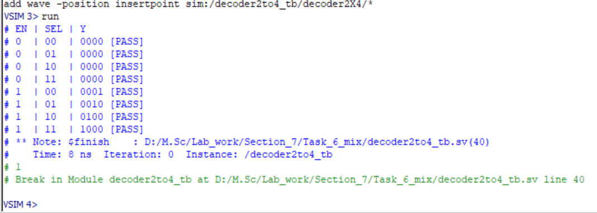
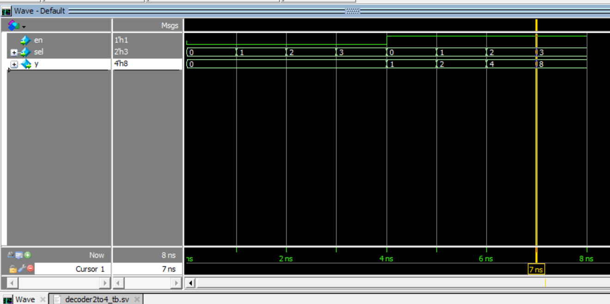
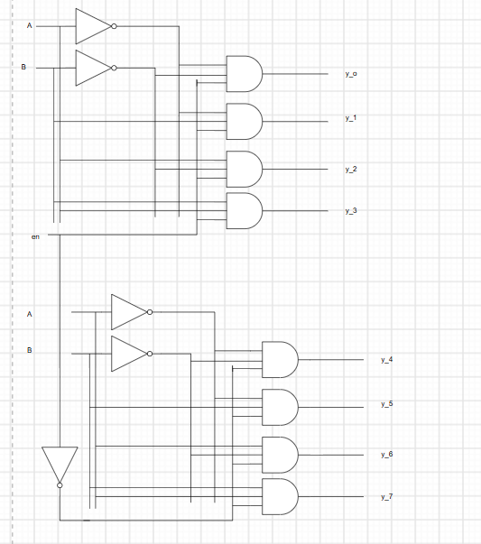
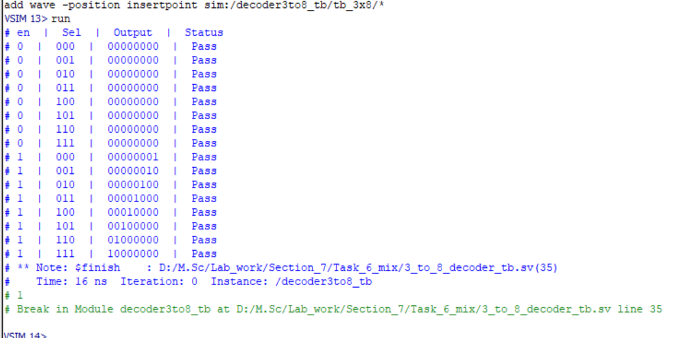
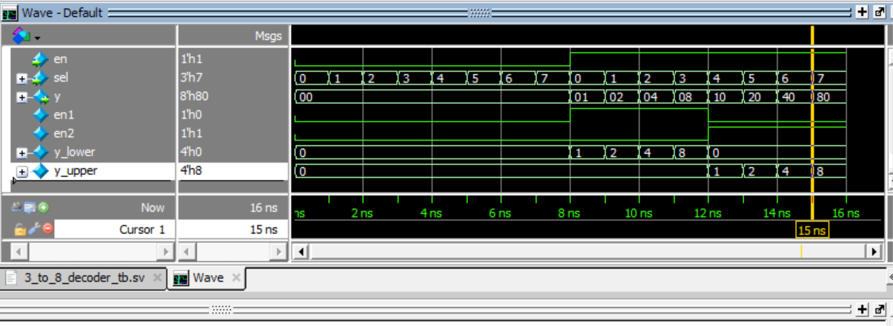
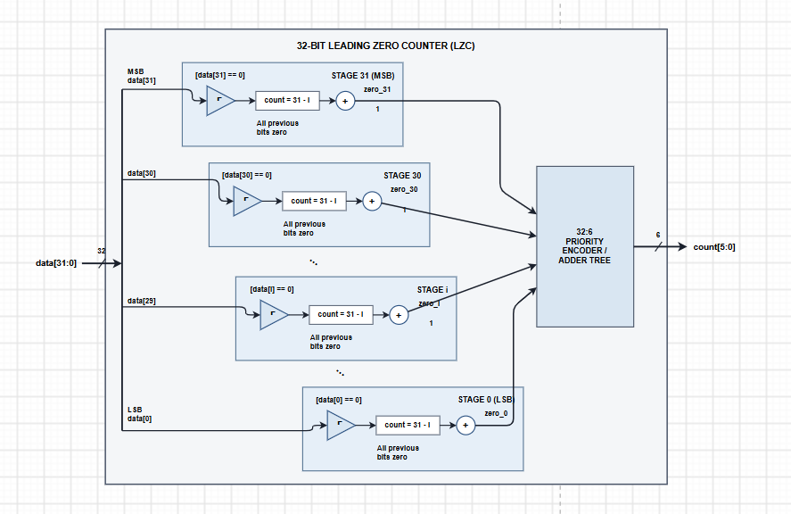
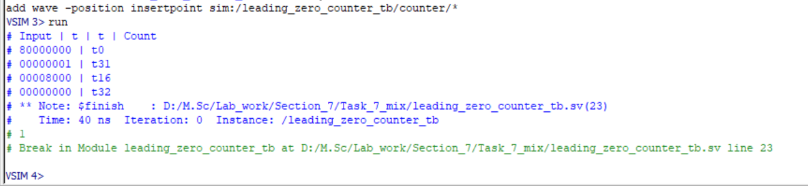
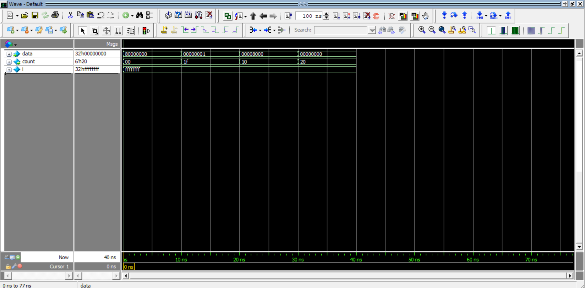

# Section 7: Decoders, Encoders & One-Hot Logic

Tool used: Questa Sim

## Task 6: 3-to-8 Decoder from 2-to-4 Decoders

First, a 2-to-4 decoder with an enable input was designed and verified as a standalone module. Then two instances of it were used, together with a little glue logic, to build the full 3-to-8 decoder. A shift expression like `8'b1 << sel` was not used.

### 2-to-4 Decoder (standalone)

#### 1. Schematic Diagram

#### 2. Terminal Output

#### 3. Waveform

---

### 3-to-8 Decoder

#### 1. Schematic Diagram

#### 2. Terminal Output

#### 3. Waveform

---

### 4. Explanation

**2-to-4 decoder.** The module `decoder2to4` has an enable `en`, a 2-bit select `sel` and a 4-bit output `y`. When `en` is 0, all outputs are forced to `0000`. When `en` is 1, exactly one output bit is high, the bit at the index given by `sel` (for example `sel = 10` gives `y = 0100`). This is a one-hot output. It is written in an `always_comb` block, and every branch assigns `y`, so no latch is created. I tested this module on its own first, before using it in the larger design.

**3-to-8 decoder.** A 3-bit select needs 8 outputs, but one 2-to-4 decoder gives only 4. So I used two 2-to-4 decoders, one for the lower four outputs and one for the upper four. The lower two select bits `sel[1:0]` go to both decoders, and the top bit `sel[2]` decides which of the two is active:

- `en1 = en & ~sel[2]` enables the lower decoder (`D1`) when `sel[2] = 0`, so it produces outputs `y[3:0]`.
- `en2 = en & sel[2]` enables the upper decoder (`D2`) when `sel[2] = 1`, so it produces outputs `y[7:4]`.

Only one of the two decoders is enabled at a time, and the disabled one outputs all zeros. Because of this, the two 4-bit results can simply be joined with concatenation: `y = {y_upper, y_lower}`. The glue logic is just two AND gates and one inverter. The overall enable `en` also feeds both of these AND gates, so when `en = 0`, both decoders are disabled and all 8 outputs are 0.

**Verification.** The testbench checks all 8 values of `sel` (000 to 111) with `en = 1` and confirms that exactly the expected output bit goes high each time. It then sets `en = 0` and confirms that all outputs are 0. The terminal output shows the results of these checks, and the waveform shows a single output bit moving from `y[0]` to `y[7]` as `sel` counts up.

---

## Task 7: 32-bit Leading Zero Counter (LZC)

### 1. Schematic Diagram

### 2. Terminal Output

### 3. Waveform

### 4. Explanation

**Simple (linear) version.** The module `leading_zero_counter_design` takes a 32-bit input `data` and gives a 6-bit `count`. The 6 bits are needed because the result can be 32 (all zeros), which does not fit in 5 bits. Inside `always_comb`, a `for` loop starts at bit 31 and moves down to bit 0. A zero bit increases `count` only if every bit above it was also zero, which is checked by `count == (31 - i)`. As soon as a 1 is found, `count` no longer matches `31 - i`, so it stops growing for the rest of the loop. This gives 31 for `32'h00000001`, 0 for `32'h80000000` and 32 for `32'h00000000`.

**Tree-structured version (description).** The tree version looks at small groups first and then merges them. Each 2-bit group produces two things: an "all zeros" flag and its own leading-zero count. Two neighbouring groups are then merged into a group of double the size:

- If the upper half is not all zeros, the result is just the upper half's count.
- If the upper half is all zeros, the result is the upper half's width plus the lower half's count.
- The merged "all zeros" flag is 1 only when both halves are all zeros.

Merging goes 2-bit, then 4-bit, then 8-bit, then 16-bit, then 32-bit. All groups at the same level work in parallel, because none of them needs the result of another group at its own level.

**Critical path and logic levels.**

- *Linear version:* every loop step uses the `count` value produced by the previous step, so the 32 steps are chained one after another. The critical path grows with the number of bits, so it is about N levels for N bits, and each level is a compare plus an increment.
- *Tree version:* there are only log2(32) = 5 merge levels after the first 2-bit stage, and each merge is a small fixed amount of logic (a mux and an add of a constant). The critical path grows with log2(N), not with N.

**Why the tree is faster for large widths.** Doubling the width adds 32 more steps to the linear chain, but adds only one more merge level to the tree. For a 32-bit input the difference is already clear, and for 64 or 128 bits it becomes much larger. The tree uses a bit more hardware, but it is much faster, which is why wide leading-zero counters are built this way.

**Verification.** The testbench checks the all-zero input, a single bit set at positions 0, 15 and 31, and a random sweep of more than 50 vectors, each compared against a for-loop reference model. The terminal output shows the results, and the waveform shows `count` changing with `data`.